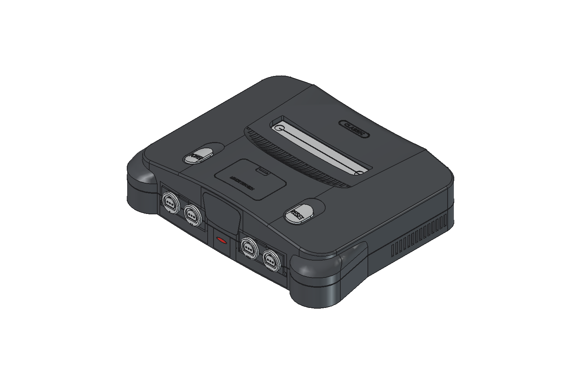
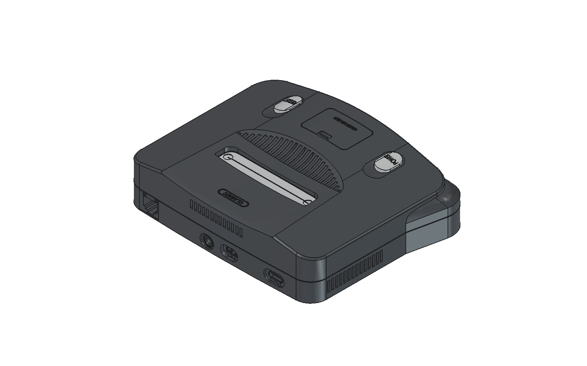
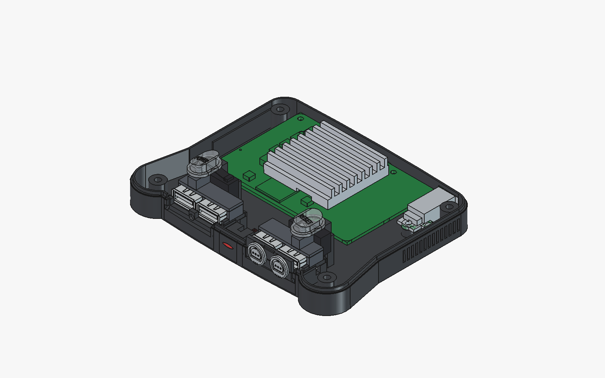
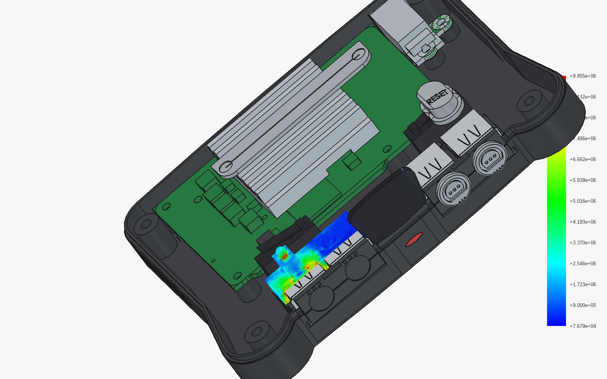
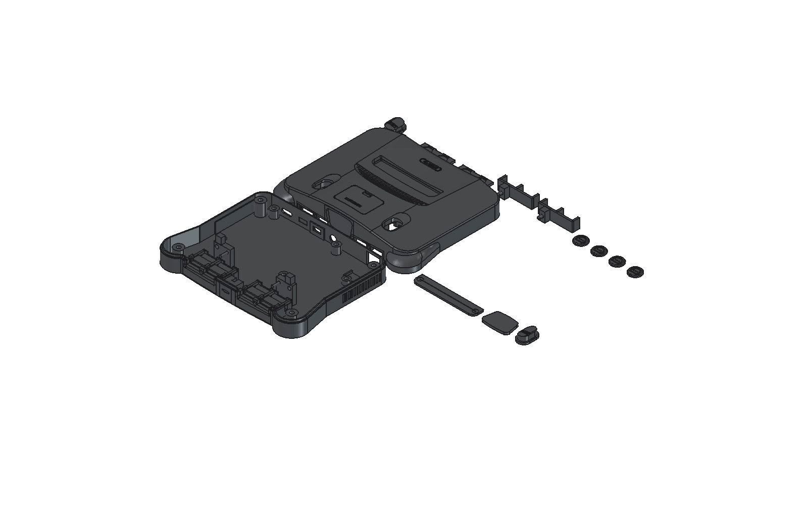

# `n64-classic-mini-cad` — 50%-Scale Parametric CadQuery Enclosure for the Radxa X4

[](https://github.com/Ryandev/n64-classic-mini-cad/actions/workflows/ci.yml)

A 100% parametric **CadQuery (OpenCASCADE B-Rep)** enclosure reproducing the classic 64-bit console silhouette at **exact 50% linear scale (`130.0 x 99.9 x 33.5 mm`)**, engineered around an inverted **Radxa X4 (`Intel Processor N100`)** single-board computer, 4 front USB-A controller ports hidden behind magnetic hinged doors, tactile **`Omron SS-5GL`** microswitches under both **`POWER`** and **`RESET`** with coaxial anti-tilt guide poles, and a `Kingbright L-93WEGW` dual-colour front status LED.

The case is checked by **135 geometry, interference and printability gate rows** (`./run gate`, which needs the reference models listed under [External sources](#external-sources)) and a first-pass FEM run (`./run fem`, see the caveat below).

---

## Downloads

Every push to `main` lints the code, builds every printed part and the print plate
([`.github/workflows/ci.yml`](.github/workflows/ci.yml)), and publishes them to the
**[latest release](https://github.com/Ryandev/n64-classic-mini-cad/releases/latest)**:

| File | Download | Contents |
|---|---|---|
| `print_plate.step` | [print_plate.step](https://github.com/Ryandev/n64-classic-mini-cad/releases/latest/download/print_plate.step) | All 15 printed bodies on one plate (`240.6 x 229.0 x 23.5 mm`), laid flat on `Z = 0` for a `256 x 256 mm` bed |
| `n64-classic-mini-cad-exports.zip` | [n64-classic-mini-cad-exports.zip](https://github.com/Ryandev/n64-classic-mini-cad/releases/latest/download/n64-classic-mini-cad-exports.zip) | Each printed part as its own STEP, the laser jig SVG, the print plate, the BOM, manufacturing and tolerance notes, `LICENSE` and `CREDITS.md` |

The geometry gate (`./run gate`) and the full console assembly check the case against
third-party models that are not in this repository (see [External sources](#external-sources)),
so they run on the maintainer's machine, not in CI.

---

## 🔗 N64 Classic Mini — Sister Repositories

| Repository | Role | Latest Build Download |
|---|---|---|
| **[`Ryandev/n64-classic-mini-cad`](https://github.com/Ryandev/n64-classic-mini-cad)** *(this repo)* | 50%-scale (`130 x 99.9 x 33.5 mm`) parametric CadQuery enclosure, Gmsh + CalculiX 3D FEM structural verification, single-plate STEP export & BOM | [`n64-classic-mini-cad-exports.zip`](https://github.com/Ryandev/n64-classic-mini-cad/releases/latest/download/n64-classic-mini-cad-exports.zip) / [`print_plate.step`](https://github.com/Ryandev/n64-classic-mini-cad/releases/latest/download/print_plate.step) |
| **[`Ryandev/es-theme-n64-classic-mini`](https://github.com/Ryandev/es-theme-n64-classic-mini)** | Batocera EmulationStation theme, 4-slot `Suspend Point List` cartridge drawer, native PC port installer, RP2040 Reset/LED firmware & theme validator | [`n64-classic-mini-theme.zip`](https://github.com/Ryandev/es-theme-n64-classic-mini/releases/latest/download/n64-classic-mini-theme.zip) |
| **[`Ryandev/n64-classic-mini-music`](https://github.com/Ryandev/n64-classic-mini-music)** | The theme's original menu music: an upbeat 32-bar loop synthesised in Python with N64-style voices | [`theme.wav`](https://github.com/Ryandev/n64-classic-mini-music/releases/latest/download/theme.wav) |

---

## Pictures

| Front | Rear: vents and I/O |
|---|---|
|  |  |

| Inside: the inverted Radxa X4, USB-A retainers and button guides | First-pass FEM (von Mises stress) on the USB retainer |
|---|---|
|  |  |

The print plate: all 15 printed bodies (`240.6 x 229.0 x 23.5 mm`).



---

## Rear plaque lettering

The rear oval plaque on `upper_shell.py` is engraved with the generic word **`CLASSIC`**
(`PLAQUE_TEXT` in [`lib/part/shared/n64_text.py`](lib/part/shared/n64_text.py), set in the
bundled DejaVu Sans Bold). To engrave your own lettering in a local build, change `PLAQUE_TEXT`,
or put traced glyph outlines in a git-ignored `local/nintendo_glyphs.py` (a `NINTENDO_GLYPHS`
tuple of `(outer, inner_loops)` polylines); the build uses that file whenever it exists.

For the front nose jewel (`front_bezel.py`), cut `bezel_laser_jig/bezel_laser_jig_0.svg` (in the release's `n64-classic-mini-cad-exports.zip`, or from `./run export`) from `3.0 mm` birch plywood on a diode laser to flush-trim `2.0 mm` clear cast acrylic and register your own Cricut-cut vinyl decal on the flat `+Y` back face.

---

## 🔬 3D Tetrahedral FEM Structural Verification (`./run fem`)

> **Caveat (2026-11-11):** these results are not yet mesh-converged. Peak stresses sit at the
> point-load nodes, and refining LC1's mesh to half size takes it past the 25 MPa limit. The
> FEM is not part of the gate. Treat the table as a first pass, not a structural sign-off.

[`lib/testing/fem_check.py`](lib/testing/fem_check.py) meshes the actual B-Rep solids with **Gmsh (`C3D4` tetrahedra)** and solves 4 linear-elastic load cases in **CalculiX (`ccx`)** ($E = 2200\,\text{MPa}$, $\nu = 0.36$, conservative FDM inter-layer tension limit $25.0\,\text{MPa}$, in-plane yield $45.0\,\text{MPa}$):

| Load Case | Component | `C3D4` Mesh | Load & Boundary Conditions | Peak Von Mises | Peak Deflection | Status |
|---|---|---|---|---|---|---|
| **`FEM_LC1`** | `usb_retainer_bracket.py` | `5,781` elems | `50 N` (`~5 kgf` `-Z`) button mash on `Z = 23.45 mm` stop block + `15 N` (`-Y`) tilt on `Ø2.80 mm` guide pole + `15 N` (`+Z`) USB-A pry | **`18.00 MPa`** (`< 25.0 MPa`) | **`0.171 mm`** at pole tip | **PASS** |
| **`FEM_LC2`** | `lower_tub.py` *(front USB & Omron bay)* | `17,096` elems | Simultaneous `40 N` (`+Y`) USB-A insertion, `30 N` (`-Y`) cable yank on `5.0 mm` pull-stop step, and `50 N` (`-Z`) rear button stop mash | **`10.94 MPa`** (`< 20.0 MPa`) | **`0.029 mm`** (`29 µm`) | **PASS** |
| **`FEM_LC3`** | `upper_shell.py` *(full dome & 25 louvers)* | `72,961` elems | `100 N` (`~10 kgf` `-Z`) crush across central barrel dome & 25 parabolic louvers | **`18.18 MPa`** (`99.9th` pct `9.98 MPa`) | Dome sag **`0.276 mm`**; button chimney radial `XY` **`0.045 mm`** (vs `0.22 mm/side` clearance) | **PASS** |
| **`FEM_LC4`** | `lower_tub.py` *(Radxa X4 & RJ45 standoffs)* | `24,538` elems | `30 N` (`-Y`) rear cable insertion shear + `60 N` (`-Z`) M2.5 screw clamp preload across 6 standoffs | **`3.37 MPa`** (`< 15.0 MPa`) | **`0.022 mm`** (`22 µm`) | **PASS** |

---

## 🛠️ Building, Testing & Documentation

```bash
./run all        # ruff lint + 134 B-Rep/printability gate rows + STEP/SVG/plate export + round-trip validation
./run fem        # run all 4 Gmsh + CalculiX 3D tetrahedral FEM structural checks
./run selftest   # run 17 planted geometry mutations to prove every gate row can fail
./run bom        # regenerate notes/BOM_COMPLETE.md from parametric subassemblies
```

- **[Complete Bill of Materials & Buyer's Guide (`notes/BOM_COMPLETE.md`)](notes/BOM_COMPLETE.md)** — Exact SKUs for the Radxa X4 (`RS119-D4E0` / `RS119-D8E0`), M.2 2230 NVMe SSD, `Omron SS-5GL` switches, `Kingbright L-93WEGW` bi-colour LED, `TE 292303-7` USB-A jacks, and `Ruthex` heat-set inserts.
- **[Manufacturing, Heat-Set Inserts, GPIO Wiring & Assembly Guide (`notes/MANUFACTURING.md`)](notes/MANUFACTURING.md)** — Print settings, 40-pin GPIO solder-pad wiring table, and 8-step top-down assembly sequence.
- **[Joint Clearances & Tolerance Ledger (`notes/TOLERANCES.md`)](notes/TOLERANCES.md)** — Per-joint (`J-01`..`J-09`) clearance table and rationale.

## External sources

The case is modelled against third-party CAD files that are **not** included here. Download them
yourself if you want to run the reference checks:

- *Nintendo 64 console* by Bruno Amaral: <https://grabcad.com/library/nintendo-64-console-1>
- *Radxa X4 V1.11 3D model* by Radxa: <https://dl.radxa.com/x/x4/radxa_x4_3d_pcba.zip>
  (mirror: <https://grabcad.com/library/radxa-x4-1>)
- *Radxa X4 heatsink 3D model* by Radxa:
  <https://dl.radxa.com/accessories/heatsink-for-x4/radxa_heatsink_for_x4_3d.zip>
- *TE Connectivity 292303-7 USB-A* from KiCad's 3D library:
  <https://gitlab.com/kicad/libraries/kicad-packages3D>

Details are in [CREDITS.md](CREDITS.md).

## Licence

[CERN-OHL-P-2.0](LICENSE), © 2026 Ryan Powell. The bundled DejaVu font keeps its own licence
(`lib/part/shared/fonts/LICENSE-DejaVu.txt`).
